# E-Gap Mobile — o EGAP no celular

Aplicativo para os servidores do **Tribunal de Justiça do Espírito Santo (TJES)** consultarem os bens patrimoniais do seu setor, fazerem a **conferência do inventário** lendo plaquetas e pedirem **materiais de consumo e permanentes**. Tudo pelo celular e sempre no setor escolhido na sessão.

O projeto tem duas partes neste repositório:

- **`egap-mobile/`**: o aplicativo (Expo / React Native, publicado também como web app em `/egap-mobile`);
- **`mobile-api`**: a API em Laravel que o app consome. Ela fica no mesmo sistema do painel web EGAP e usa as mesmas regras de negócio.

> Trabalho de Conclusão de Curso de Lucas César. Ele também será usado em produção pelos servidores do TJES.

---

## Sumário

1. [Visão geral](#1-visão-geral)
2. [Telas](#2-telas)
3. [Arquitetura](#3-arquitetura)
4. [Sessão mobile × sessão web](#4-sessão-mobile--sessão-web)
5. [Login e escolha de setor](#5-login-e-escolha-de-setor)
6. [Conferência: leitura de plaqueta](#6-conferência-leitura-de-plaqueta)
7. [Pedido de materiais](#7-pedido-de-materiais)
8. [Notificações](#8-notificações)
9. [Modelo de dados](#9-modelo-de-dados)
10. [Endpoints da API](#10-endpoints-da-api)
11. [Como rodar](#11-como-rodar)
12. [Testes e verificação](#12-testes-e-verificação)
13. [Estrutura de pastas](#13-estrutura-de-pastas)
14. [Decisões de projeto](#14-decisões-de-projeto)

---

## 1. Visão geral

### Para quem

Servidores do TJES que respondem pelos bens de um setor. Muitos têm mais de uma **lotação**, ou seja, trabalham em mais de um setor. Por isso o app pede o setor depois do login e permite trocar de setor depois.

### O que o app faz

| Área | Funcionalidade |
|---|---|
| **Todas as abas** | Seletor de setor no cabeçalho e sino de notificações com contador de não lidas. |
| **Início** | Saudação, setor atual, anel de progresso da conferência, nº de bens, pedidos em análise (de todos os setores), valores de aquisição e atual do setor, últimas leituras feitas no aparelho. |
| **Bens** | Lista paginada (rolagem infinita) dos bens do setor, com foto do material e busca por patrimônio, descrição, série, marca ou modelo. Mostra o detalhe completo de cada bem; a foto amplia com pinça e toque duplo. |
| **Ler plaqueta** | Botão central da barra: câmera (código de barras) ou digitação. Fora da conferência, abre o detalhe do bem. Dentro da conferência, registra a leitura (ou guarda na fila, se estiver sem rede). |
| **Conferência** | Inventário atual, prazo do setor (faixa vermelha nos últimos 7 dias), progresso, filtros por status (pendentes, localizados, não localizados, divergentes…), leitura, divergência com o valor encontrado por campo, não localizados com justificativa ("Selecionar todos os pendentes"), resumo e finalização do setor. |
| **Pedidos** | Histórico do usuário em **todos os setores** (o card mostra o setor), detalhe do pedido com itens e situação, e novo pedido de **consumo** ou **permanente**: catálogo com fotos → carrinho → envio. |
| **Notificações** | Avisos do inventário (abertura, lembrete de prazo, reabertura de setor) e dos pedidos do usuário; tocar abre a tela relacionada. |
| **Perfil** | Dados da sessão, trocar setor, tema (sistema/claro/escuro), tutorial e sair. |

### Por que uma nova versão

A primeira versão do app funcionava, mas a sessão mobile não seguia o modelo do painel web: usava a lotação legada mais recente e **não deixava trocar de setor**. A regra de escopo estava copiada em cada controller e as telas tinham até ~2.100 linhas. Esta versão reescreve o app e a API com **as mesmas finalidades e as mesmas regras de negócio**, com:

- uma sessão mobile com o mesmo "esqueleto" da sessão do painel web (`EgapSession`), guardada por token;
- o setor **sempre decidido no servidor**, nunca enviado pelo cliente nas rotas de dados;
- uma API enxuta, com o escopo resolvido uma vez por requisição;
- um app organizado em camadas (telas finas, hooks de dados, cliente tipado) e com visual novo.

---

## 2. Telas

Capturas do build web publicado (`/egap-mobile`), em viewport de celular (390×844) e tema escuro, com o usuário de teste `mobile.teste`. Atualizadas em 13/11/2026.

| Login | Escolha do setor | Início |
|:---:|:---:|:---:|
| 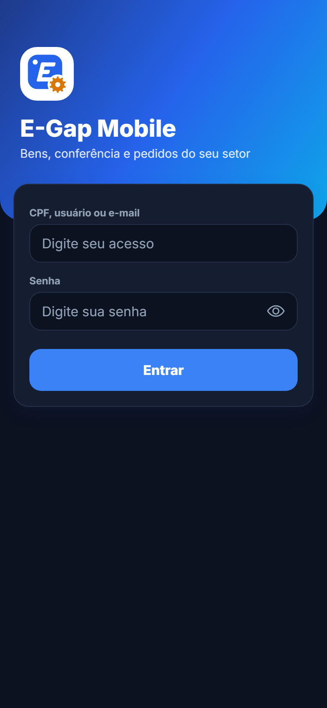 | 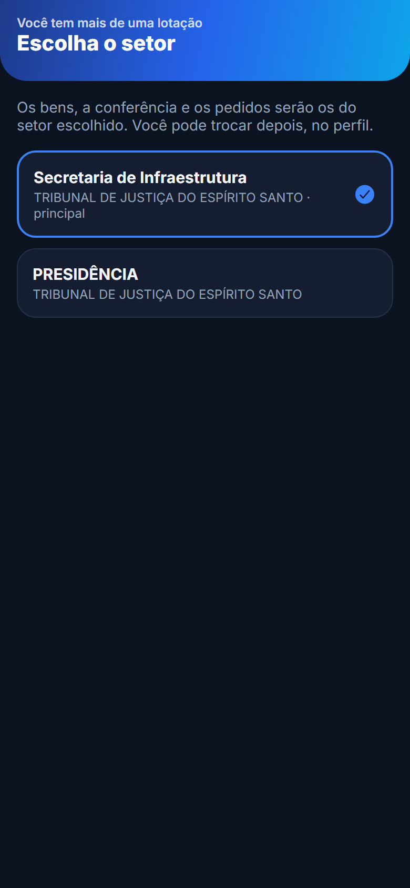 | 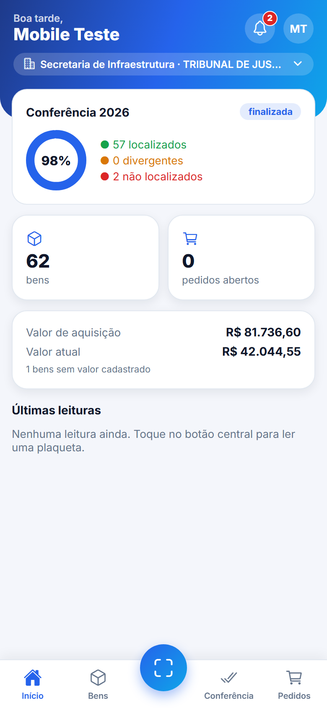 |
| **Troca de setor (cabeçalho)** | **Bens** | **Detalhe do bem** |
| 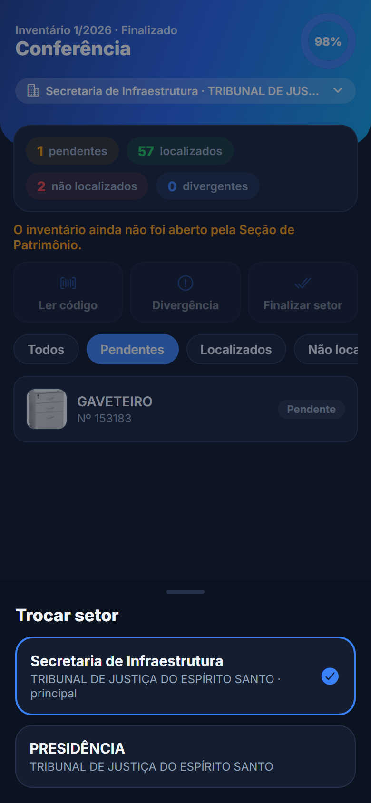 | 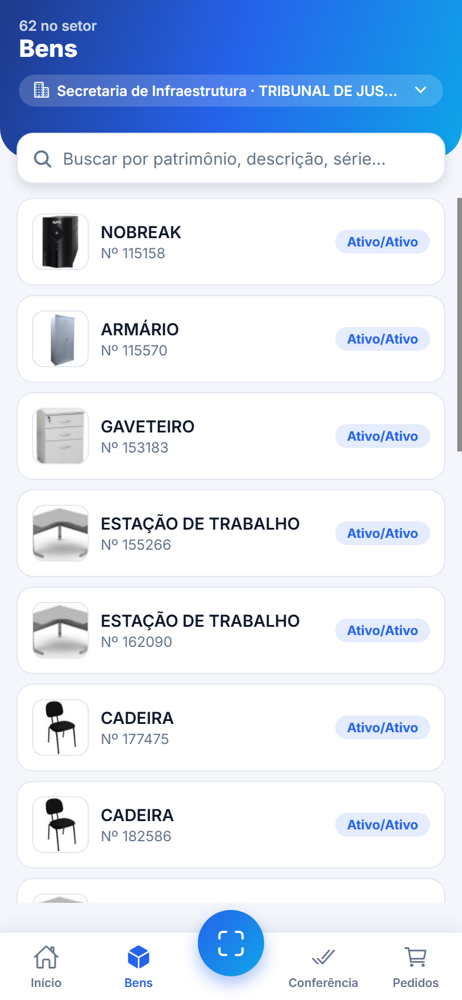 | 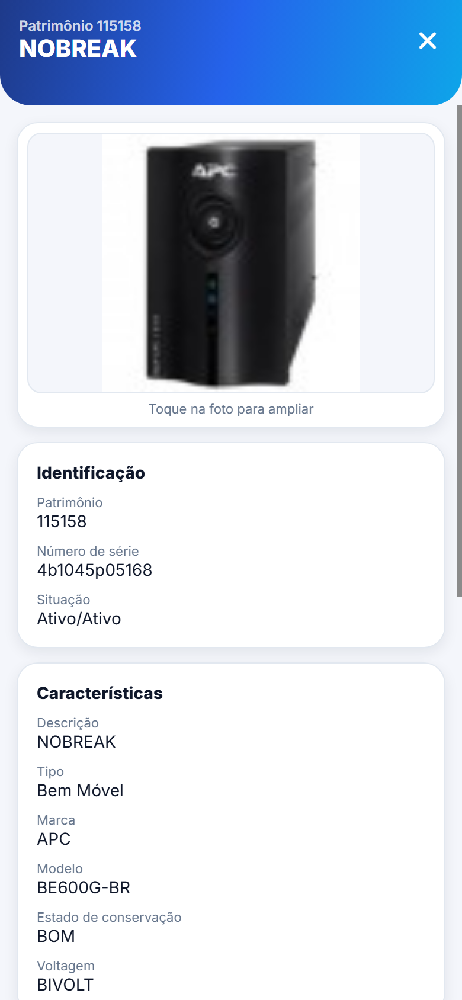 |
| **Conferência** | **Pedidos** | **Catálogo (consumo)** |
| 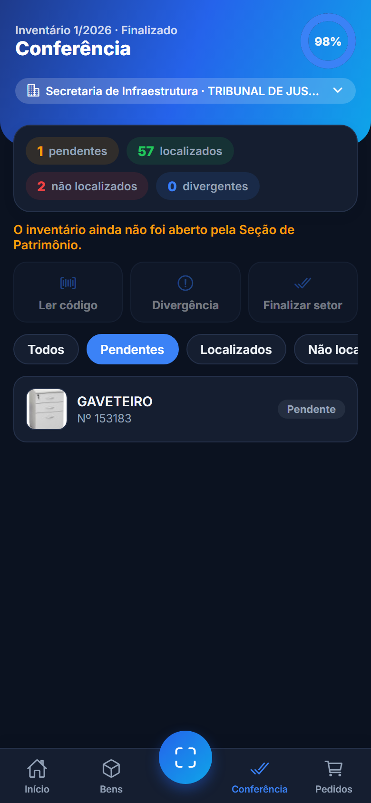 | 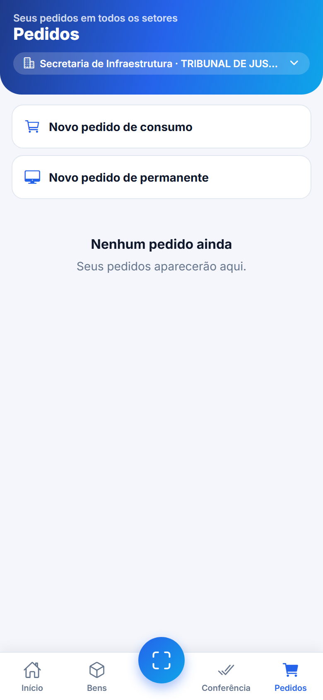 | 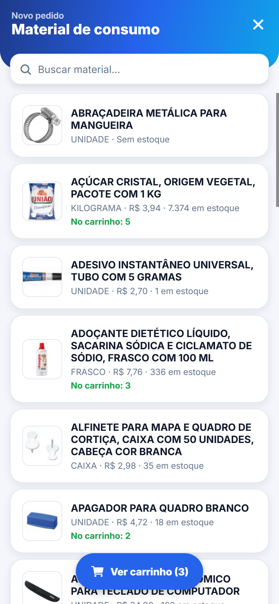 |
| **Carrinho** | **Aviso de notificações** | **Notificações** |
| 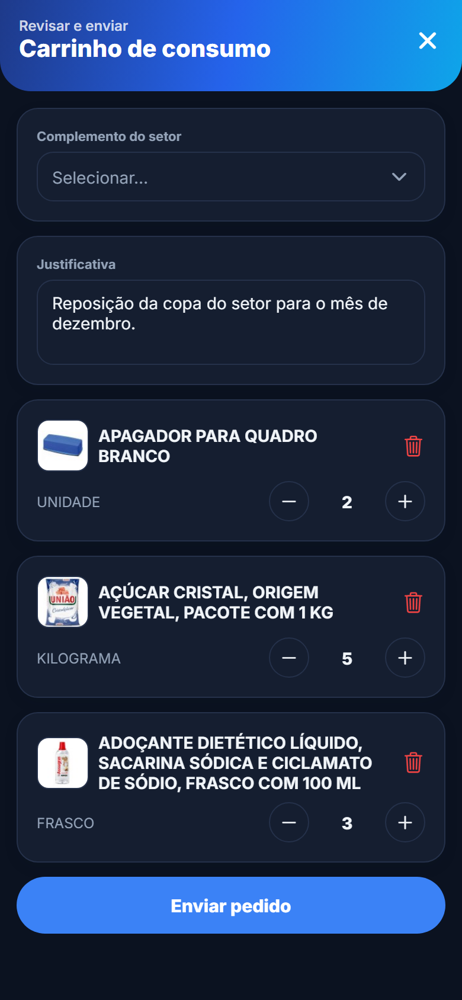 | 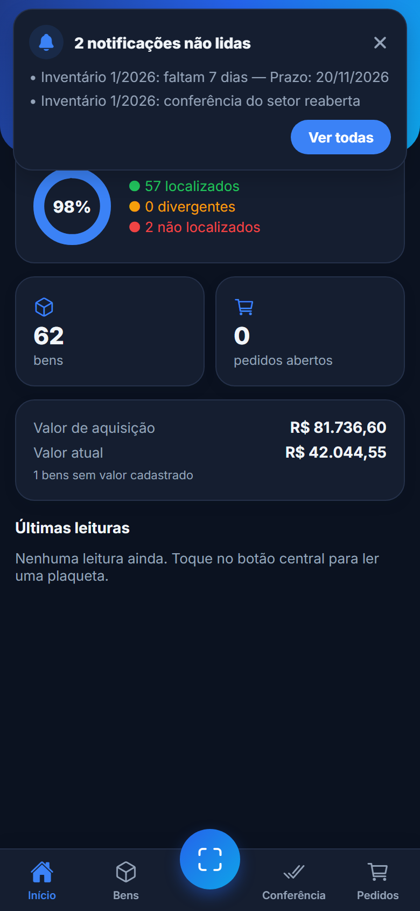 | 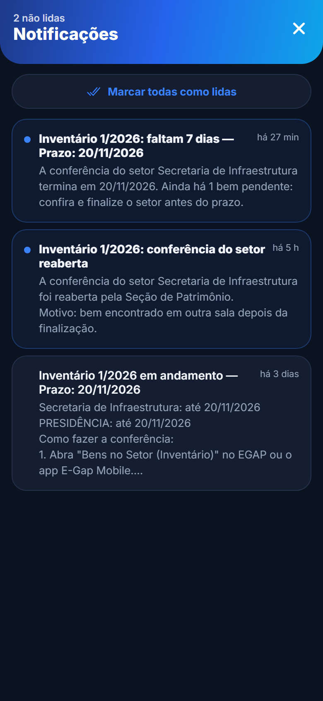 |
| **Perfil** | | |
| 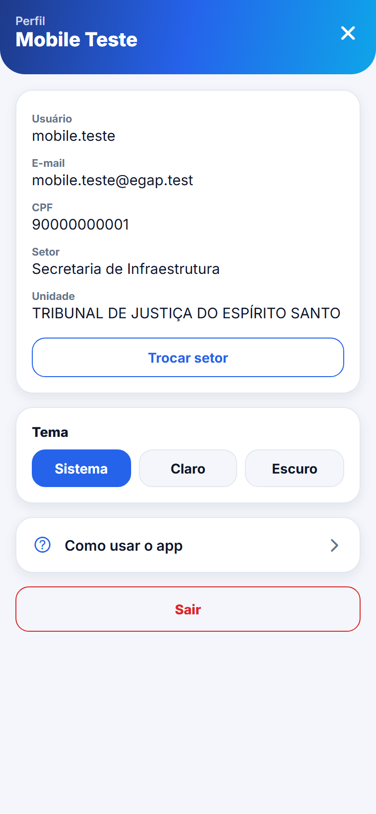 | | |

> Nas capturas, nenhum inventário estava "Em execução" no banco, por isso a conferência aparece bloqueada e com as ações desabilitadas. O usuário de teste não tem pedidos, então o histórico e o detalhe do pedido não aparecem. As notificações foram criadas só para a captura e apagadas depois. A tela de leitura usa a câmera do aparelho e não aparece aqui.

---

## 3. Arquitetura

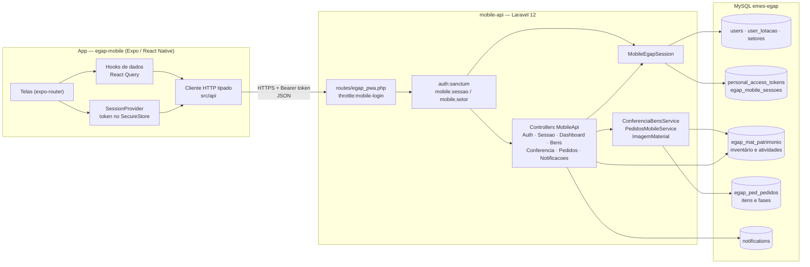

| Camada | Tecnologia |
|---|---|
| App | Expo SDK 58, React Native 0.88, React 19.3, expo-router 58, TypeScript 6 estrito, `@tanstack/react-query` (cache e requisições), `@shopify/flash-list` (listas grandes), `expo-camera` (código de barras), `expo-secure-store` (token) |
| API | PHP 8.4, Laravel 12, Laravel Sanctum 4 (token `mobile-app`), Form Requests e API Resources |
| Painel web (mesmo sistema) | Filament 4. A API reaproveita a regra de lotação e os services de conferência e pedidos que o painel também usa. |
| Banco | MySQL `emes-egap`, compartilhado com o painel. Conexões `emes` (sem prefixo) e `egap` (prefixo `egap_`). |

**Distribuição**: o build web do app é publicado em `public/egap-mobile` e servido pela rota `/egap-mobile/{path?}` do Laravel. O app abre em `/egap-mobile` e chama a API em `/mobile-api`, no mesmo domínio.

---

## 4. Sessão mobile × sessão web

O painel web guarda o contexto do usuário (vínculo EGAP, dados pessoais e setor escolhido) na **sessão HTTP**, pela classe `EgapSession`. Um aplicativo não tem sessão HTTP, então a **`MobileEgapSession`** guarda o mesmo bloco numa linha da tabela **`egap_mobile_sessoes`**, presa ao token Sanctum do aparelho.

A regra que decide **qual setor vale** foi extraída para o trait `ResolveLotacaoEgap` e é a mesma nos dois lados. A `EgapSession` passou a usar o trait sem mudar de comportamento.

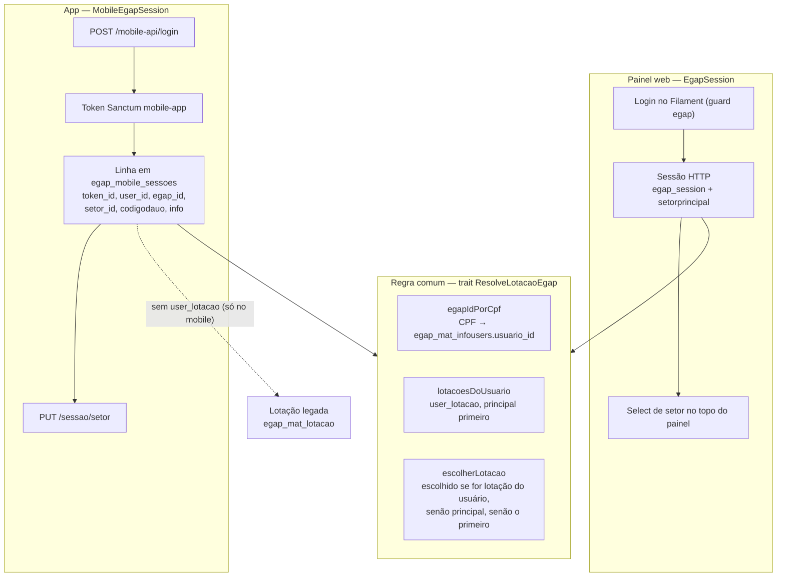

**Pontos importantes**

- **Isolamento**: cada aparelho tem o seu token e a sua linha em `egap_mobile_sessoes`. Trocar de setor no celular **não altera** o setor do painel web nem o de outro aparelho do mesmo usuário.
- **Mesmo acesso do painel**: só entra quem está com `users.ativo = 1` **e** tem a permissão `egap_access` **ou** é administrador EGAP (mesma regra do `canAccessPanel`). O login aceita CPF, usuário ou e-mail, com o mesmo mapeamento do `LoginEgap` web (e-mail → `email`, numérico → `cpf`, senão `login`).
- **Lotação legada**: quem ainda não tem registro em `user_lotacao` usa a primeira lotação de `egap_mat_lotacao` (pelo `egap_id`). Nesse caso a lista tem um item só e não há troca de setor. Isso vale apenas no mobile.
- **Reavaliado a cada requisição**: o middleware carrega a sessão uma vez por requisição. Se o usuário perder o acesso depois do login, recebe `403`. Se perder a lotação escolhida, o setor volta para a principal (ou a primeira) na requisição seguinte.
- **Logout** apaga o token. A linha de `egap_mobile_sessoes` cai junto (FK com `cascadeOnDelete`).

### Middlewares e erros

| Middleware | Onde | Resposta de erro |
|---|---|---|
| `throttle:mobile-login` | `POST /login` | `429`: 5 tentativas por minuto por login + IP. O limiter usa o store `file` (`CACHE_LIMITER`), que persiste entre requisições. |
| `auth:sanctum` | todas as outras rotas | `401` sem token válido |
| `mobile.sessao` (`GarantirSessaoMobile`) | sessão, troca de setor, logout e rotas de dados | `401 sessao_invalida` (token sem linha em `egap_mobile_sessoes`, por exemplo de um app antigo) · `403 sem_acesso` |
| `mobile.setor` (mesmo middleware com `:setor`) | dashboard, bens, conferência, pedidos | `409 sem_lotacao` quando não há setor/unidade resolvidos |

Todos os erros seguem o formato `{"message": "...", "code"?: "...", "errors"?: {...}}`. No app, qualquer `401` apaga o token e volta para o login. Falhas de rede ou `5xx` abrem a tela de erro com "Tentar novamente".

---

## 5. Login e escolha de setor

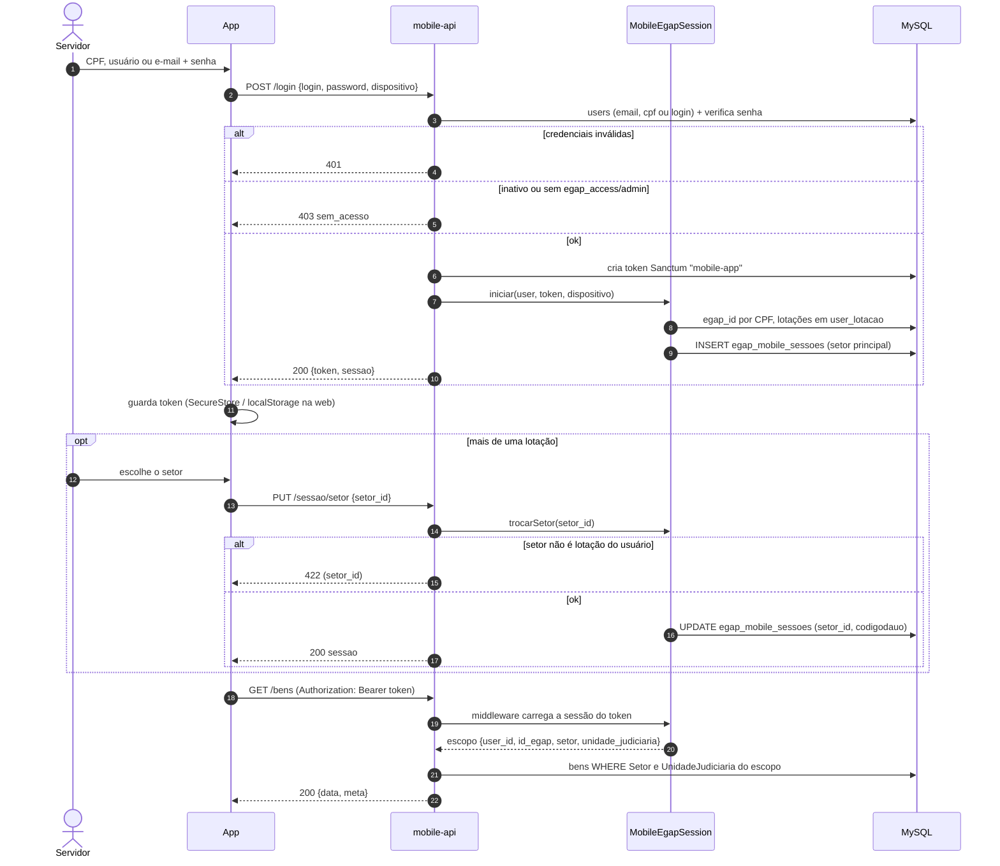

O escopo `{user_id, id_egap, setor, unidade_judiciaria}` é o mesmo contrato que os services já recebiam do painel web. Por isso as regras de negócio não precisaram mudar. A `unidade_judiciaria` é o `codigodauo` do setor escolhido.

---

## 6. Conferência: leitura de plaqueta

Durante o inventário, o servidor lê a plaqueta de cada bem. O app envia o código para **`POST /conferencia/leituras`**, que **valida e já localiza** numa única chamada. O código é normalizado: `" 104.552 "` vira `104552` e zeros à esquerda são tolerados.

Quando a conferência aceita gravar:

- só o inventário **"Em execução"** aceita leituras e alterações. "A inventariar" fica só para consulta, e um inventário concluído responde `403`;
- o setor precisa estar na **abrangência** do inventário. O **prazo** do setor (`prazo`, `prazo_vencido`) só avisa: a conferência continua aceita depois dele;
- gravar exige vínculo com o EGAP (`egap_id`), para o item não ficar sem autor;
- a atividade do setor fica bloqueada depois de finalizada ou em "carga efetuada", e o app mostra o motivo.

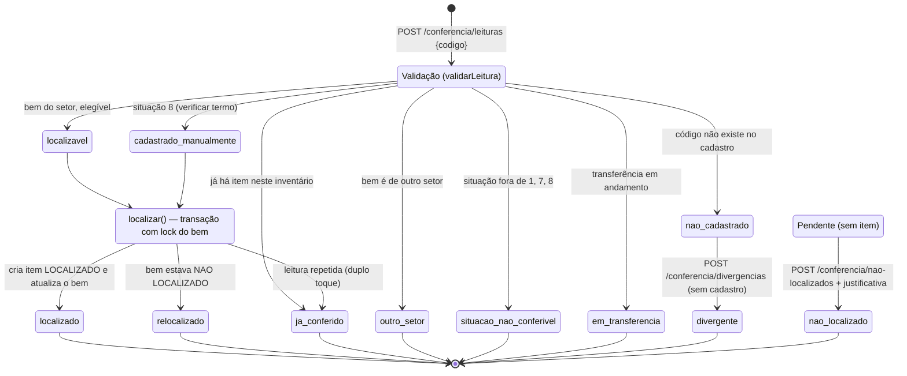

| Status devolvido | Significado | O que o app mostra |
|---|---|---|
| `localizado` | Item `LOCALIZADO` criado no inventário e bem atualizado (`sit_inventario`, `id_inventario`, `Usuario`) | Sucesso, com vibração |
| `relocalizado` | O bem estava marcado como não localizado e voltou a `LOCALIZADO` | "Bem reencontrado" |
| `ja_conferido` | Bem (ou código sem cadastro) já registrado neste inventário. Não duplica. | Aviso |
| `outro_setor` | O bem pertence a outro setor | Aviso, com a divergência já preenchida |
| `situacao_nao_conferivel` | Situação do bem fora das elegíveis (1, 7, 8) | Aviso |
| `em_transferencia` | Há transferência do bem em andamento | Aviso |
| `nao_cadastrado` | Código não encontrado no cadastro | Botão para **registrar divergência** |

`cadastrado_manualmente` (situação 8) e `localizavel` não aparecem na resposta como estado final: os dois seguem para `localizar()` e voltam como `localizado`.

Outras ações da conferência:

- **Divergência** (`POST /conferencia/divergencias`): com bem cadastrado (campos divergentes, o **valor encontrado** de cada campo em `valores` e observação) ou sem cadastro (só o código). O valor encontrado vai para as colunas do item; as colunas `*_egap` guardam o cadastro.
- **Não localizados** (`POST /conferencia/nao-localizados`): marca com uma justificativa os bens escolhidos (`bem_ids`) ou todos os pendentes do setor (`todos_pendentes`). Só grava bens ainda pendentes e devolve quais foram registrados e quais foram ignorados.
- **Finalizar setor** (`POST /conferencia/finalizar`): só sem pendências (`409` se houver). O app mostra um resumo antes. Depois disso a atividade do setor fica bloqueada (`403` para novas alterações) até alguém reabrir o setor no painel, com justificativa.
- **Progresso**: o anel usa `total_conferivel` (pendentes + já conferidos). Bens em transferência e cadastrados sem termo não entram na conta.

Observações e justificativas vão até 255 caracteres (o tamanho da coluna). As regras (situações elegíveis, bloqueio da atividade, transações com `lockForUpdate` do bem) estão em `ConferenciaBensService`. As transações abrem na conexão `emes`, a mesma dos models: na conexão `egap` elas não envolviam as gravações.

### Leituras sem rede

No subsolo ou no almoxarifado, a leitura que falha por falta de rede fica numa **fila no aparelho** (`src/conferencia/FilaLeituras.tsx`). A fila é reenviada em ordem a cada 30 s e quando o app volta ao primeiro plano. Cada leitura guarda o setor em que foi feita e só sai quando a sessão estiver nesse setor. Reenviar é seguro: uma repetição volta como `ja_conferido`. As recusas (por exemplo, setor já finalizado) ficam visíveis para o usuário, e a fila é apagada no logout. Toda requisição do app tem limite de 15 s.

---

## 7. Pedido de materiais

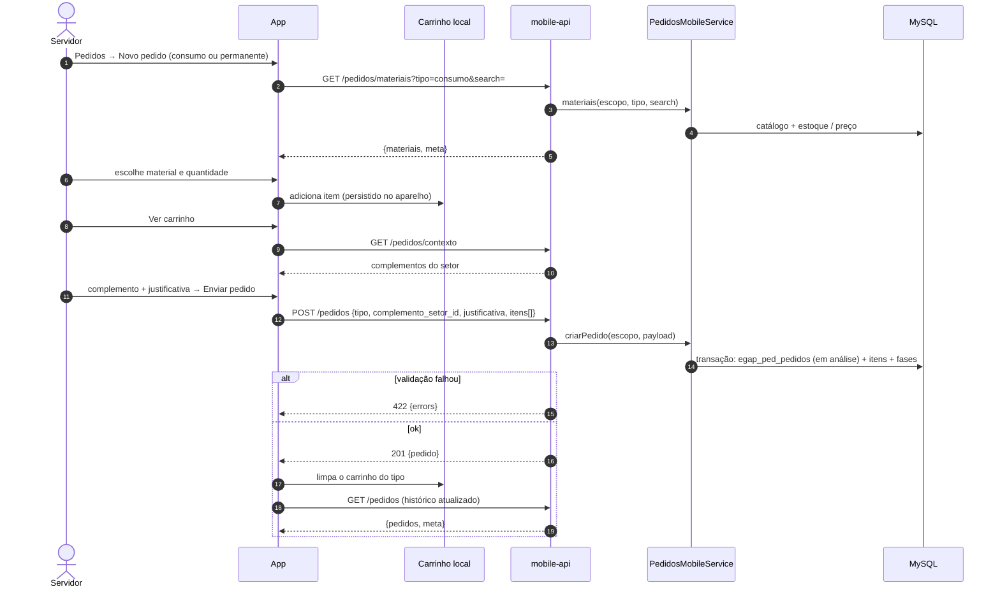

- **Consumo**: justificativa geral obrigatória (até 300 caracteres). O pedido vai para o almoxarifado.
- **Permanente**: cada item exige justificativa e tipo de atendimento (**adição** ou **substituição**, que exige o patrimônio substituído). O pedido vai para o patrimônio. São as mesmas regras do carrinho do Ambiente Externo.
- O carrinho fica salvo no aparelho (no SecureStore em pedaços, ou no `localStorage` na web). Ele sobrevive a uma queda de rede e é apagado no logout.
- O **histórico** (`GET /pedidos`) e o contador de pedidos em análise do Início trazem os pedidos do usuário em **todos os setores**, porque o pedido pertence ao solicitante. O card mostra o setor, e `GET /pedidos/{id}` abre o detalhe com itens e situação.
- Pedidos exigem vínculo EGAP (`egap_id`, achado pelo CPF). Sem ele, a API responde `403 sem_vinculo_egap` (ou `403 sem_lotacao`) e a aba Pedidos mostra uma explicação no lugar do erro.
- O catálogo, o carrinho e o histórico mostram a foto do material (`imagem_url`, da descrição detalhada ou da resumida). A URL usa o protocolo e o host da requisição, então funciona atrás de proxy HTTPS.

---

## 8. Notificações

O app lê as mesmas notificações de banco (`notifications`) que o painel web mostra ao usuário.

| Origem | Avisos |
|---|---|
| `NotificadorInventario` | Inventário aberto, lembrete de prazo do setor (com a contagem de pendentes, ou "só falta finalizar") e reabertura de setor |
| `NotificadorPedido` | Pedido criado, mudança de situação do pedido ou de um item, fase registrada |

Cada notificação leva em `viewData` o `tipo` e a `rota_app`, a tela que o app abre ao tocar (por exemplo, `/pedidos/123`). A API devolve o corpo como texto puro (sem HTML), 20 por página, com o total de não lidas. O app mostra o sino com contador no cabeçalho, a tela de notificações e um aviso flutuante quando chega uma nova.

---

## 9. Modelo de dados

Só as tabelas que o app usa. A única tabela nova do projeto é `egap_mobile_sessoes`. As demais já existiam no sistema, inclusive `notifications`, a tabela padrão do Laravel que o painel já usava.

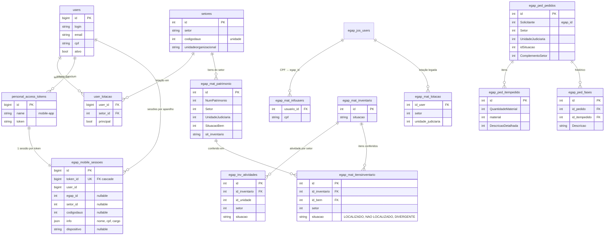

A migration `database/migrations/2026_10_22_120000_create_egap_mobile_sessoes_table.php` cria a tabela na conexão `emes` com o nome físico explícito `egap_mobile_sessoes`. Assim a FK para `personal_access_tokens` não recebe o prefixo `egap_`.

---

## 10. Endpoints da API

Prefixo `mobile-api`. Rotas em `routes/egap_pwa.php` e controllers em `app/Http/Controllers/Egap/MobileApi/`.

| Método | Rota | Middleware | Descrição |
|---|---|---|---|
| POST | `/login` | `throttle:mobile-login` | `{login, password, dispositivo?}` → `200 {token, sessao}` · `401` · `403 sem_acesso` · `429` |
| GET | `/sessao` | sanctum + `mobile.sessao` | Sessão atual: usuário, `egap_id`, `setor_atual`, `lotacoes[]`, `lotacao_legada` |
| PUT | `/sessao/setor` | sanctum + `mobile.sessao` | `{setor_id}` → troca o setor desta sessão (`422` se não for lotação do usuário) |
| POST | `/logout` | sanctum + `mobile.sessao` | Apaga o token (a sessão cai em cascata) |
| GET | `/notificacoes?page=` | sanctum + `mobile.sessao` | Notificações do usuário, 20 por página → `{notificacoes[], meta{…, nao_lidas}}` |
| POST | `/notificacoes/{id}/lida` | sanctum + `mobile.sessao` | Marca uma como lida → `204` (`404` se for de outro usuário) |
| POST | `/notificacoes/lidas` | sanctum + `mobile.sessao` | Marca todas como lidas → `204` |
| GET | `/dashboard` | + `mobile.setor` | `{bens{total, situacoes[]}, financeiro{valor_aquisicao, valor_atual, sem_valor}, conferencia, pedidos_abertos}` (`pedidos_abertos` conta todos os setores) |
| GET | `/bens?search=&page=&per_page=` | + `mobile.setor` | Bens do setor (situações 1, 7, 8), com `imagem_url`, `per_page` até 50 → `{data[], meta}` |
| GET | `/bens/{patrimonio}` | + `mobile.setor` | Detalhe com `pertence_ao_setor` e `situacao_elegivel` (`404` se não existir) |
| GET | `/conferencia` | + `mobile.setor` | Inventário atual, atividade do setor (com motivo do bloqueio, `prazo`, `prazo_vencido`) e resumo por status com `total_conferivel` |
| GET | `/conferencia/bens?status=&page=` | + `mobile.setor` | Bens por status: `todos`, `pendente`, `localizado`, `nao_localizado`, `divergente`, `em_transferencia`, `cadastrado_manualmente` |
| POST | `/conferencia/leituras` | + `mobile.setor` | `{codigo}` → valida e localiza (ver [seção 6](#6-conferência-leitura-de-plaqueta)) |
| POST | `/conferencia/nao-localizados` | + `mobile.setor` | `{bem_ids[] \| todos_pendentes, justificativa}` → registrados e ignorados |
| POST | `/conferencia/divergencias` | + `mobile.setor` | `{bem_id? , codigo?, campos[]?, valores{}?, observacao}` → `201` |
| POST | `/conferencia/finalizar` | + `mobile.setor` | Finaliza a atividade do setor (`409` com pendências) |
| GET | `/pedidos?page=&per_page=` | + `mobile.setor` | Histórico do usuário em todos os setores → `{pedidos[], meta}` |
| GET | `/pedidos/{id}` | + `mobile.setor` | Detalhe de um pedido do usuário, com itens (`404` se não for dele) |
| GET | `/pedidos/contexto` | + `mobile.setor` | `{scope, complementos[]}` |
| GET | `/pedidos/materiais?tipo=&search=&page=` | + `mobile.setor` | Catálogo `consumo` ou `permanente`, com fotos → `{materiais[], meta}` |
| POST | `/pedidos` | + `mobile.setor` | `{tipo, complemento_setor_id, justificativa?, itens[{material_id, quantidade, tipo_atendimento?, justificativa?, patrimonio_substituido?}]}` → `201` · `403 sem_vinculo_egap` |

Nenhuma rota de dados aceita setor vindo do cliente. O setor só muda por `PUT /sessao/setor`.

---

## 11. Como rodar

### Pré-requisitos

PHP 8.4 com Composer, Node.js com npm, MySQL com o banco `emes-egap` configurado no `.env` do Laravel.

### Backend (Laravel)

```bash
composer install

# cria só a tabela nova (o banco é compartilhado: não rode "migrate" sem --path)
php artisan migrate --path=database/migrations/2026_10_22_120000_create_egap_mobile_sessoes_table.php

# usuário de teste: mobile.teste / mobile123 (duas lotações, permissão de acesso e vínculo EGAP)
php artisan db:seed --class="Database\Seeders\MobileApiTestUsersSeeder"

php artisan serve --port=8000
```

A API fica em `http://127.0.0.1:8000/mobile-api`.

### App em desenvolvimento

Crie `egap-mobile/.env.local`:

```text
EXPO_PUBLIC_API_URL=http://127.0.0.1:8000/mobile-api
```

```bash
cd egap-mobile
npm install
npx expo start          # Expo Go / emulador (a tecla w abre a versão web)
npx expo start --web    # direto no navegador
```

> No celular físico, use o IP da máquina na rede em vez de `127.0.0.1`.
> Para rodar a versão web local em `localhost:8081`, o navegador precisa que a API responda com cabeçalhos CORS em `mobile-api/*`. Veja `config/cors.php`.

### Publicar o build web (substitui `public/egap-mobile`)

No **Git Bash**, dentro de `egap-mobile/`:

```bash
MSYS_NO_PATHCONV=1 EXPO_NO_DOTENV=1 EXPO_PUBLIC_API_URL=/mobile-api \
  npx expo export --platform web --clear --max-workers 1 --output-dir ../public/egap-mobile
```

| Parte | Por quê |
|---|---|
| `MSYS_NO_PATHCONV=1` | Impede o Git Bash de converter `/mobile-api` num caminho do Windows (`C:/Program Files/Git/mobile-api`). |
| `EXPO_NO_DOTENV=1` | Ignora o `.env.local` de desenvolvimento, para o build não sair apontando para `127.0.0.1`. |
| `EXPO_PUBLIC_API_URL=/mobile-api` | URL relativa da API no servidor de produção. Ela é embutida no bundle no momento do export. |
| `--clear` | Limpa o cache do Metro, para nenhuma variável de ambiente antiga ficar no bundle. |
| `--max-workers 1` | Evita estourar a memória ("Zone Allocation failed") em máquinas com pouca RAM. |
| `--output-dir ../public/egap-mobile` | Grava o build onde o Laravel serve o app (rota `/egap-mobile/{path?}`). O `baseUrl` `/egap-mobile` já está em `app.json`. |

> O export apaga a pasta de saída antes de gerar o build. Se ele falhar no meio, `public/egap-mobile` fica vazia: rode de novo antes de commitar. Depois, confira que o bundle contém `"/mobile-api"` e não contém `127.0.0.1`.

---

## 12. Testes e verificação

### API (PHPUnit)

```bash
php artisan test tests/Feature/MobileApi
```

Os testes rodam no **banco real**, cada um dentro de uma transação desfeita ao final (`DatabaseTransactions` nas conexões `emes` e `egap`). Usam usuários fictícios criados na hora ou dados reais escolhidos por consulta, e marcam o teste como *skipped* quando o banco não tem o dado necessário. As tabelas `egap_inv_atividades`, `egap_inv_comissao` e `egap_inv_equipes` são MyISAM e não voltam com a transação: os testes que gravam nelas usam o trait `LimpaTabelasMyIsamDoInventario`.

| Arquivo | Cobre |
|---|---|
| `AutenticacaoTest` | login por usuário, e-mail e CPF, senha errada, inativo, sem `egap_access`, throttle (inclusive com espaços no login), token sem sessão e usuário removido (`401`), troca de setor, logout, perda de acesso depois do login, `409 sem_lotacao` |
| `MobileEgapSessionTest` | setor principal por padrão, troca válida, recusa de setor alheio, dois tokens independentes, não altera a sessão web, setor removido cai para a principal, lotação legada, contrato do escopo |
| `MobileSessaoTabelaTest` | colunas da tabela e sessão apagada junto com o token |
| `BensTest` | só bens do setor da sessão, troca de setor, `per_page` limitado, detalhe com `pertence_ao_setor`, `404`, formato do dashboard |
| `ConferenciaTest` | leitura localiza e a segunda vira `ja_conferido`, código com espaços e pontuação, outro setor, código inexistente, lista por status, não localizados, divergência, rotas antigas removidas, transferências validadas consultadas uma vez e guardadas em cache |
| `PedidosTest` | contexto e catálogo, tipo inválido, justificativas obrigatórias (consumo, permanente, substituição), item inválido não grava o pedido pela metade, setor do cliente ignorado, histórico e pedidos abertos de todos os setores, usuário sem cadastro EGAP |
| `NotificacoesTest` | exige sessão, lista só as do usuário, marca uma e todas como lidas, não marca a de outro usuário |
| `ImagemMaterialTest` | URL da foto do material e foto nos bens e no catálogo |
| `AppWebTest` | build web servido em `/egap-mobile` e redirecionamento do endereço antigo |

Também valem para as regras compartilhadas com o painel web: `tests/Unit`, `tests/Feature/EgapCarrinhoDestinoTest.php` e os testes do inventário (`EgapCicloInventarioTest` cobre o ciclo completo: abertura, avisos, conferência pelo app e pelo painel, finalização e conclusão).

> A suíte inteira (`php artisan test`) estoura o limite de memória do `phpunit.xml`, mesmo sem alterações. Rode um arquivo por processo: `for f in $(find tests/Unit tests/Feature -name "*Test.php"); do php artisan test "$f"; done`. Há falhas antigas sem relação com o app: `CourseQuestionInterpreterTest` depende da data e `PedagogicalFlowTest` depende de um banco SQLite que não existe.

### App

```bash
cd egap-mobile
npx tsc --noEmit     # tipos
npx expo lint        # ESLint (config Expo)
```

---

## 13. Estrutura de pastas

```text
app/
  Filament/Egap/Auth/
    EgapSession.php                 # sessão do painel web (sessão HTTP)
    MobileEgapSession.php           # sessão do app (egap_mobile_sessoes)
    Concerns/ResolveLotacaoEgap.php # regra comum: egap_id, lotações, setor válido
  Http/
    Controllers/Egap/MobileApi/     # MobileAuth, Sessao, Dashboard, Bens, Conferencia, Pedidos, Notificacoes
    Middleware/Egap/GarantirSessaoMobile.php   # mobile.sessao / mobile.setor
    Requests/Egap/MobileApi/        # validação (Login, TrocarSetor, Leitura, Divergencia…)
    Resources/Egap/MobileApi/       # SessaoResource, BemResource
  Models/egap/MobileSessao.php
  Services/Egap/Mobile/             # ConferenciaBensService, PedidosMobileService, ImagemMaterial
  Services/Egap/Inventario/NotificadorInventario.php
  Services/Egap/Pedidos/NotificadorPedido.php
database/
  migrations/2026_10_22_120000_create_egap_mobile_sessoes_table.php
  Egap/seeders/MobileApiTestUsersSeeder.php
routes/egap_pwa.php                 # rotas mobile-api
tests/Feature/MobileApi/            # testes da API
public/egap-mobile/                  # build web publicado do app

egap-mobile/
  app/                    # telas (expo-router)
    index.tsx             #   login / restauração da sessão
    setor.tsx             #   escolha do setor
    (tabs)/               #   Início · Bens · Conferência · Pedidos
    bem/[patrimonio].tsx  #   detalhe do bem
    leitura.tsx           #   ler plaqueta (câmera ou digitação)
    pedidos/              #   novo (catálogo), carrinho e detalhe ([id].tsx)
    notificacoes.tsx      #   lista de notificações
    perfil.tsx, tutorial.tsx, erro.tsx
  src/
    api/          # cliente HTTP (ApiError, Bearer, limite de 15 s) e módulos por recurso, tipados
    hooks/        # hooks React Query (bens, conferência, dashboard, pedidos, notificações, erro de rede)
    session/      # SessionProvider e armazenamento do token
    cart/         # carrinho de pedidos persistido no aparelho
    conferencia/  # fila de leituras feitas sem rede
    components/   # cartões, anel de progresso, scanner, seletor de setor, sino, fotos, folhas, listas
    theme/        # tokens de cor (claro/escuro) e ThemeProvider
    utils/        # formatação, armazenamento local, situação do pedido, últimas leituras
  docs/telas/     # capturas usadas neste README
```

---

## 14. Decisões de projeto

- **Token Sanctum + tabela de sessão presa ao token**, e não cache: a sessão sobrevive a reinícios do servidor e some sozinha quando o token é apagado.
- **O setor vem sempre do servidor**: as rotas de dados ignoram qualquer setor do cliente. Assim ninguém consulta ou altera bens fora das suas lotações.
- **Regra de lotação única** (`ResolveLotacaoEgap`) para web e mobile, sem mudar o comportamento da `EgapSession`.
- **Services preservados**: `ConferenciaBensService` e `PedidosMobileService` mantêm o contrato do array de escopo, porque o painel web também os usa. Só a montagem do escopo mudou.
- **Leitura unificada**: validar e localizar numa chamada só (`POST /conferencia/leituras`), o que significa menos idas e voltas na rede durante o inventário. O lock no bem evita item duplicado em toque duplo.
- **Transações na conexão dos models** (`emes`): uma transação aberta na conexão `egap` não envolvia as gravações, e o `lockForUpdate` não segurava nada.
- **Fila só para leituras**: a leitura é a ação repetida em campo e é segura de reenviar. Divergências, não localizados e finalização continuam exigindo rede.
- **Pedidos por solicitante**: o histórico não filtra pelo setor da sessão, porque o mesmo servidor pede por mais de um setor e quer ver todos os pedidos num lugar só.
- **Sem alterar o banco**: o MySQL é compartilhado com o sistema principal. Fora `egap_mobile_sessoes`, tudo foi resolvido com as colunas que já existiam.
- **Desempenho**: uma carga de sessão por requisição, colunas explícitas e eager loading só do necessário, dashboard em poucas agregações, paginação em todas as listas. No app, cache com React Query e listas virtualizadas com FlashList.
- **Transição**: tokens do app antigo não têm linha em `egap_mobile_sessoes` e por isso recebem `401 sessao_invalida`, o que leva ao novo login. O build novo substituiu `public/egap-mobile`.

### Próximos passos

- Permissão própria para pedidos/inventário no lugar de `egap_access`.
- Modo offline também para divergências e não localizados (hoje só as leituras entram na fila).